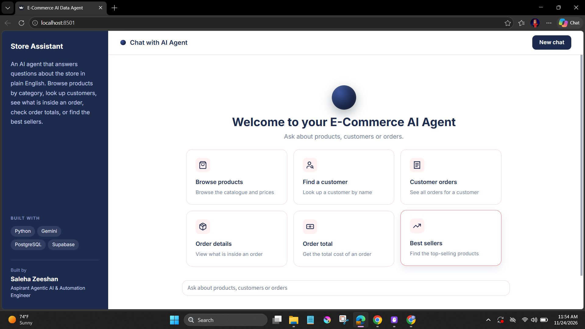
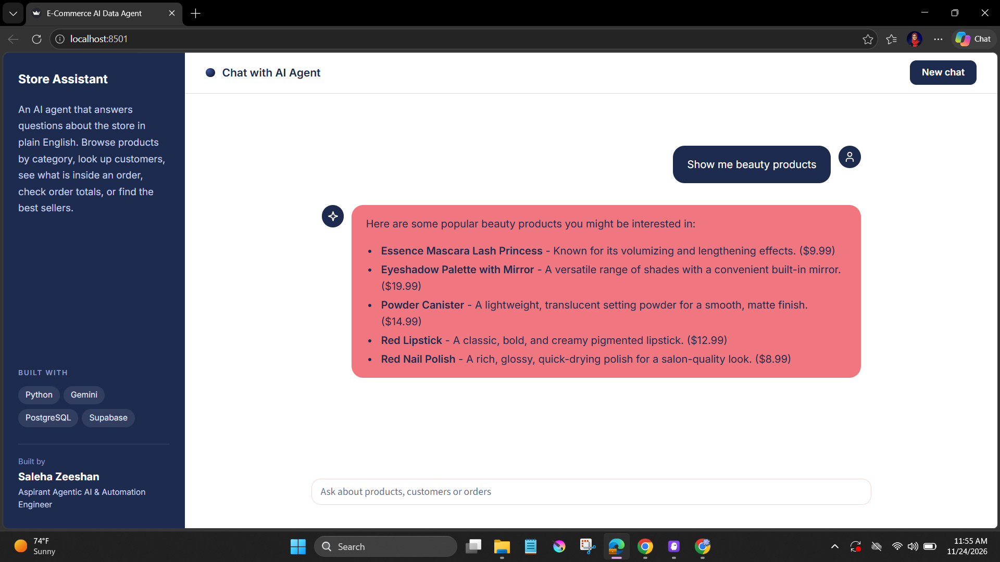
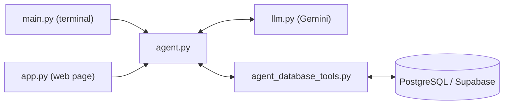

# E-Commerce AI Data Agent

An app where you ask questions about an online store in plain English, in the terminal or on a web page. Gemini decides which database tool to call, the tool runs SQL on PostgreSQL, and Gemini turns the result into an answer.

It is built on an ETL pipeline that loads data from the DummyJSON API into Supabase (PostgreSQL), plus an agent layer on top that can chain several tools for one question.

## Screenshots

**Welcome screen**



**Chat**



## What it looks like in the terminal

```
Ask any question: What orders did Emily place?
```

For that one question the agent made three tool calls on its own:

1. `get_orders_by_customer("Emily")` found orders 1 and 103
2. `get_order_details(1)`
3. `get_order_details(103)`

Then it answered:

```
There are two customers named Emily in the system. Here are their orders:

Emily Johnson (Order #1):
  Generic Motorcycle: 3 units - $11,999.97
  iPhone 6: 3 units - $899.97
  Baseball Ball: 2 units - $17.98
  Blue Frock: 4 units - $119.96

Emily Brown (Order #103):
  Cat Food: 2 units - $17.98
  Red Onions: 5 units - $9.95
  Soft Drinks: 4 units - $7.96
```

More examples:

```
Ask any question: What's the total of order 104?
The total for order 104 is $1,120.23 (containing 27 items).

Ask any question: Top 3 best-selling products?
1. Cat Food (37 sold)
2. Generic Motorcycle (28 sold)
3. Apple Airpods (27 sold)
```

## How it works



`agent.py` runs a loop. It sends the question to Gemini. If Gemini asks for a tool, the agent runs it and sends the result back. That repeats, up to 5 rounds, until Gemini replies with plain text.

The web page (`app.py`) is built with Streamlit and custom CSS. It has a fixed sidebar and navbar, and example cards that fill the message box so you can edit a question before sending it. It uses the same agent and the same error handling as the terminal version.

## Tools

| Tool | Answers |
|---|---|
| `search_products(category)` | "Show me beauty products" |
| `get_customer_by_name(customer_name)` | "Find customer Emily" |
| `get_orders_by_customer(customer_name)` | "What orders did Emily place?" |
| `get_order_details(order_id)` | "What's in order 1?" |
| `get_order_total(order_id)` | "What's the total of order 104?" |
| `get_top_products(limit)` | "Top 3 best-selling products?" |

Totals and rankings are computed in SQL on purpose. In one early run Gemini added up an order by itself and was off by $1, which is why `get_order_total` exists.

## Error handling

The agent is meant to fail with a readable message instead of a traceback. It has four custom error types (busy, rejected request, unusable response, tool failure). Temporary failures (timeouts, 429, 5xx) are retried three times with a short wait. Permanent ones (bad key, unknown model) are not retried, because the same request will fail the same way.

I tested these on purpose: a broken API key, a 0.001 second timeout, an unknown tool name, and a plain "hello" with no tool needed. The full story is in [DEBUGGING_JOURNEY.md](DEBUGGING_JOURNEY.md).

## Tech stack

Python, `requests`, `python-dotenv`, Streamlit, PostgreSQL on Supabase, Gemini API (`/v1beta/interactions`), DummyJSON as the data source.

<!-- TODO: add the database driver you use, for example psycopg2 -->

## Setup

1. Clone the repo and install dependencies: `pip install requests python-dotenv streamlit` plus your database driver.
2. Create a `.env` file with `GEMINI_API_KEY` and the database variables read in `database.py`.
3. Run the ETL (`extract.py`, `transform.py`, `load.py`) to fill the database.
4. Run the terminal version with `python main.py`.
5. Or run the web page with `streamlit run app.py`. It opens at `http://localhost:8501`.

## How I built this

I had already learned how to build an ETL pipeline in an earlier project, so I wrote this one myself and used AI only to ask me questions and review my logic. I also wrote the first agent tool from scratch.

For the later parts (error handling, the multi-tool loop and four more tools) I designed each feature in conversation with an AI assistant. My rule was to understand and discuss the logic first, then write pseudocode and list edge cases, and only then use Kiro to generate the code. After that I read the generated code, tested it, and fixed what broke. Several decisions were mine, for example dropping a tool because the `status` column turned out to be empty, and skipping a backup model to keep the project focused.

I designed the web page myself (layout, colour palette and behaviour) and built it with AI help, then adjusted it over several rounds by testing it in the browser.

I wrote the request headers, body and call to the Gemini API by hand with `requests`, instead of using the client library, because I wanted to understand what is actually sent. I chose the Interactions endpoint after comparing it with plain text generation and reading the documentation. That endpoint is experimental, and it was also the source of my worst bug hunt (see the journey file).

## Docs

- [DEBUGGING_JOURNEY.md](DEBUGGING_JOURNEY.md): what broke, how I found out, what I learned
- [PROJECT_CONTEXT.md](PROJECT_CONTEXT.md): file layout, schema and reference notes
